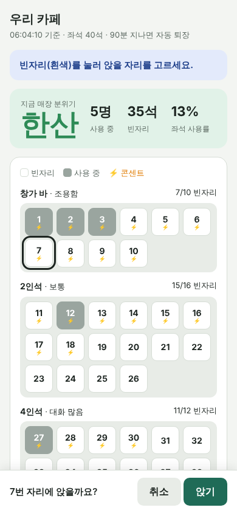
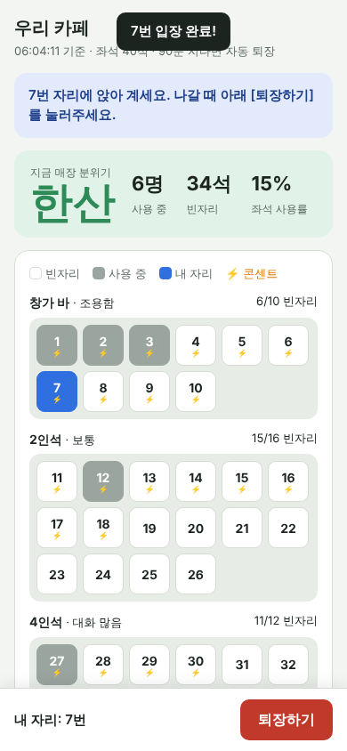
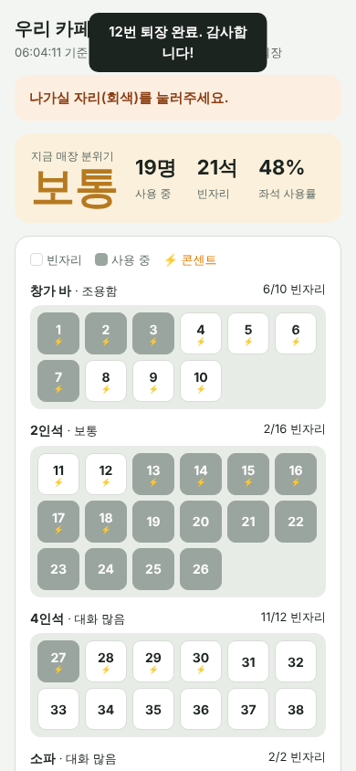

# cafe-seat-qr

[한국어](README.md) | **English**

A free seat check-in system for small cafes. Guests **scan a QR code, pick an empty seat** on a seat map, and **free it when they leave**. A live seat map shows free seats and how busy the cafe is, updating every 5 seconds.
It runs entirely on Google Sheets + Apps Script: **no server, no cost**, and a cafe owner can set it up with one Google account in about 20 minutes.

<p>



</p>

## What it does

| Page | URL | What happens |
| --- | --- | --- |
| Check in | `…/exec?p=in` | Tap a free (white) seat on the map to sit. Your seat turns blue |
| Check out | `…/exec?p=out` | Free your seat (the **퇴장하기 / Leave** button on the check-in page does the same) |
| Live map | `…/exec` | Free / taken seats and a crowd level (calm / moderate / busy), refreshed every 5 seconds |

- If a guest forgets to check out, the seat frees itself **after 90 minutes**.
- If two people tap the same seat at once, **only one** gets it.
- Seats with a power outlet are marked, and each zone shows how many seats are free.
- The sheet stores only **time, seat number and in/out**. No names, phone numbers or other personal data.

The guest-facing text is in Korean. To translate it, edit the strings in `apps-script/Code.gs` (see [docs/CUSTOMIZE_EN.md](docs/CUSTOMIZE_EN.md)).

## Setup (about 20 minutes)

Full step-by-step instructions: **[docs/SETUP_EN.md](docs/SETUP_EN.md)**. An illustrated Korean guide is in [docs/설치가이드.html](docs/설치가이드.html).

1. **Create a Google Sheet** with the cafe owner's account: [sheets.new](https://sheets.new)
2. **Paste the code**: in the sheet, *Extensions → Apps Script*, replace everything with [`apps-script/Code.gs`](apps-script/Code.gs), save
3. **Deploy as a web app**: *Deploy → New deployment → Web app*, execute as **Me**, access **Anyone**, authorize, copy the `/exec` URL
4. **Make the QR codes**: open [`tools/qr-maker.html`](tools/qr-maker.html), paste the URL, and print the check-in, check-out and live-map QR codes (works offline)
5. **Test**: scan the check-in QR with a phone, take a seat, and watch it change on the live map

> Download: green **Code** button at the top of this page → **Download ZIP** → unzip

## Make it yours

Cafe name, seat layout, auto-checkout time and crowd thresholds are a few lines at the top of `Code.gs`. See **[docs/CUSTOMIZE_EN.md](docs/CUSTOMIZE_EN.md)**.

After editing the code, publish it with **Deploy → Manage deployments → ✏️ Edit → Version: New version → Deploy**. Choosing *New deployment* instead creates a new URL, and your printed QR codes would stop matching.

## Troubleshooting

| Symptom | Fix |
| --- | --- |
| Other people see "Sorry, unable to open the file" | *Manage deployments → Edit* → set access to **Anyone** |
| Fails on one phone only | That browser is signed in to several Google accounts. Open the link in a private / incognito tab |
| You changed the code but see the old page | You saved but did not redeploy. *Manage deployments → New version* |
| You want to erase test check-ins | In the Apps Script editor, choose `clearLog` from the function list → ▷ Run |

## Limitations

- There is no login. A guest's seat is remembered in their phone's browser, and the check-out page does not stop someone from freeing another guest's seat. A QR code per seat, or a short check-in code, can close this gap.
- It runs within Google Apps Script's free quotas. That is plenty for a small cafe; check the quotas for very busy stores.
- Create the sheet and script with **the cafe owner's account** so the owner controls the data.

## Files

```
apps-script/Code.gs       Google Apps Script code (the only file to paste)
docs/SETUP_EN.md          English setup guide
docs/CUSTOMIZE_EN.md      English customization guide
docs/설치가이드.html        Illustrated setup guide (Korean)
docs/커스터마이즈.md        Customization guide (Korean)
docs/images/              Screenshots
tools/qr-maker.html       Make the three QR codes (offline)
tools/qrcode.js           QR library (Kazuhiko Arase, MIT)
```

## License

MIT. See [LICENSE](LICENSE). `tools/qrcode.js` is © Kazuhiko Arase, MIT license.
