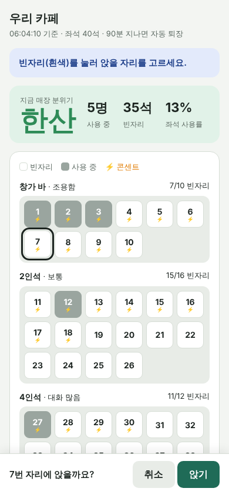
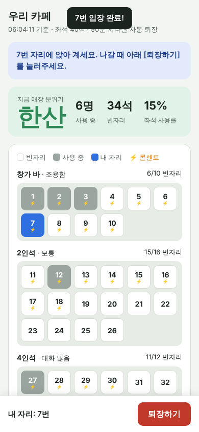
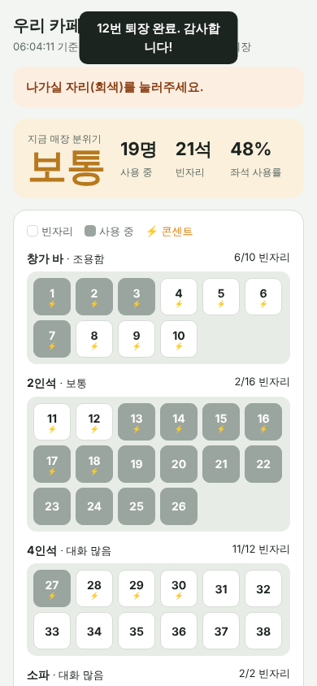
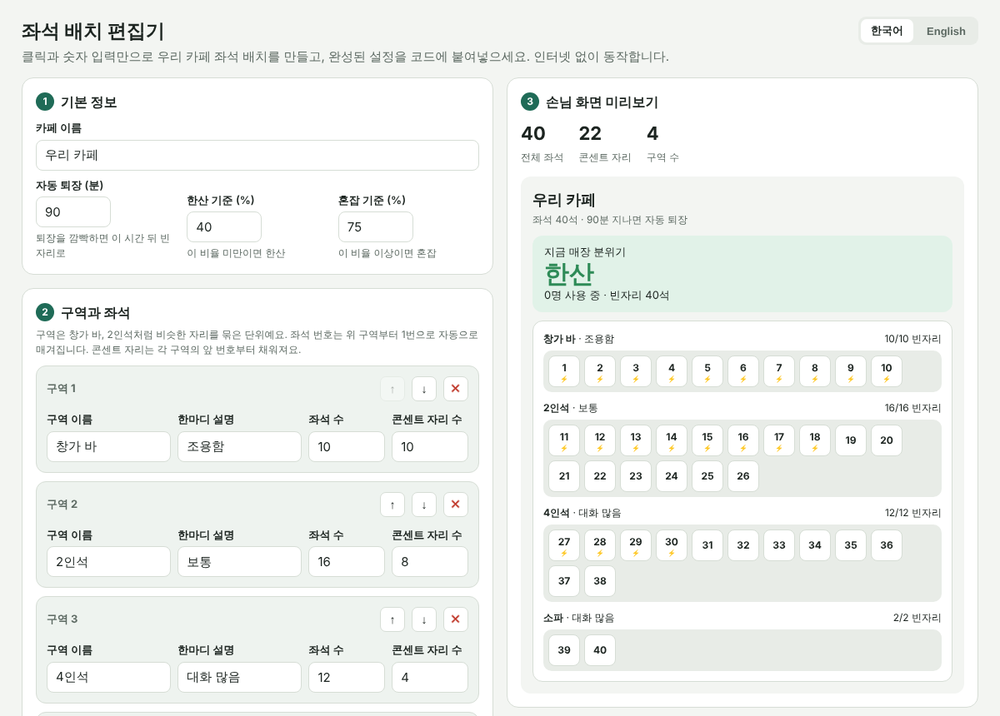

# cafe-seat-qr

**한국어** | [English](README.en.md)

손님이 QR을 찍고 **빈자리를 직접 골라 앉고**, 나갈 때 **자리를 비우면**, 매장 좌석 현황이 **실시간으로** 바뀌는 카페 좌석 체크인 시스템입니다.
구글 시트와 Apps Script만 쓰기 때문에 **서버도 비용도 필요 없고**, 카페 사장님 구글 계정 하나로 20분 안에 만들 수 있어요.

<p>



</p>

## 무엇을 할 수 있나요

| 화면 | 주소 | 하는 일 |
| --- | --- | --- |
| 입장 | `…/exec?p=in` | 좌석 배치도에서 빈자리(흰색)를 눌러 앉기. 내 자리는 파란색 |
| 퇴장 | `…/exec?p=out` | 내 자리를 비우기 (입장 화면의 **퇴장하기** 버튼도 같은 일) |
| 좌석 현황 | `…/exec` | 빈자리, 사용 중, 한산 / 보통 / 혼잡을 5초마다 자동 갱신 |

- 퇴장을 깜빡해도 **90분 뒤 자동으로** 빈자리가 됩니다.
- 두 사람이 같은 자리를 동시에 눌러도 **한 명만** 앉아집니다.
- 콘센트 자리 표시, 구역별(창가 바, 2인석 등) 빈자리 수를 보여줍니다.
- 시트에는 **시간, 좌석 번호, 입장/퇴장**만 기록됩니다. 이름이나 전화번호 같은 개인정보는 받지 않아요.

## 설치 (20분)

그림으로 된 안내서가 있어요. 저장소를 내려받은 뒤 **[docs/설치가이드.html](docs/설치가이드.html)** 을 브라우저로 여세요. 코드 복사 버튼이 들어 있습니다.

간단히 요약하면 이렇습니다.

1. **구글 시트 만들기**: 사장님 계정으로 [sheets.new](https://sheets.new)
2. **코드 붙여넣기**: 시트에서 확장 프로그램 → Apps Script → [`apps-script/Code.gs`](apps-script/Code.gs) 내용 전체를 붙여넣고 저장
3. **웹 앱 배포**: 배포 → 새 배포 → 웹 앱 → 실행: **나**, 액세스: **모든 사용자** → 권한 승인 → `/exec` 주소 복사
4. **QR 만들기**: [`tools/qr-maker.html`](tools/qr-maker.html) 을 열고 주소를 붙여넣으면 입장 · 퇴장 · 좌석 현황 QR 세 장이 나옵니다 (인터넷 없이 동작)
5. **확인**: 휴대폰으로 입장 QR을 찍어 자리에 앉고, 좌석 현황 화면에서 바뀌는지 확인

> 내려받기: 이 페이지 위쪽 초록색 **Code** 버튼 → **Download ZIP** → 압축 풀기

## 우리 카페에 맞게 바꾸기

카페마다 좌석 구조가 다르죠. **[`tools/seat-editor.html`](tools/seat-editor.html)** (좌석 배치 편집기)을 열면 코드를 몰라도 클릭과 숫자 입력만으로 바꿀 수 있어요.

- 구역(창가 바, 2인석, 루프탑 등)을 추가 · 삭제 · 순서 변경
- 구역마다 좌석 수와 콘센트 자리 수 입력 → 좌석 번호는 자동으로 매겨짐
- 카페 이름, 자동 퇴장 시간, 한산/혼잡 기준
- 손님 화면 미리보기가 바로 바뀌고, 완성되면 **[복사]** → `Code.gs`의 `설정 시작` ~ `설정 끝` 사이에 붙여넣기



직접 코드를 고치고 싶다면 **[docs/커스터마이즈.md](docs/커스터마이즈.md)** 를 보세요.

코드를 고친 뒤에는 **배포 → 배포 관리 → ✏️ → 버전: 새 버전 → 배포** 로 반영하세요. "새 배포"를 누르면 주소가 바뀌어 QR을 다시 만들어야 합니다.

## 자주 생기는 문제

| 증상 | 해결 |
| --- | --- |
| 다른 사람 폰에서 "Sorry, unable to open the file" | 배포 관리 → ✏️ → 액세스 권한을 **모든 사용자**로 |
| 특정 폰에서만 안 열림 | 구글 계정이 여러 개 로그인된 브라우저 문제. 시크릿 탭으로 열기 |
| 코드를 고쳤는데 옛날 화면이 나옴 | 저장만 하고 재배포를 안 한 경우. 배포 관리 → 새 버전 |
| 테스트 기록을 지우고 싶음 | 편집기 함수 목록에서 `clearLog` 선택 → ▷ 실행 |

## 한계

- 로그인이 없어서 "내 자리"는 손님 휴대폰 브라우저에 저장됩니다. 퇴장 화면에서 다른 사람 자리를 비우는 것도 막혀 있지 않아요. 필요하면 자리마다 QR을 따로 붙이거나 입장 번호를 주는 방식으로 보완할 수 있습니다.
- 구글 Apps Script의 무료 사용량 안에서 동작합니다. 작은 카페 규모에는 충분하지만, 손님이 아주 많은 매장은 확인이 필요해요.
- 시트와 스크립트는 **카페 사장님 계정**에서 만들어야 기록을 사장님이 직접 관리할 수 있습니다.

## 폴더 구성

```
apps-script/Code.gs       구글 Apps Script 코드 (이것 하나만 붙여넣으면 됨)
docs/설치가이드.html        그림으로 보는 설치 안내 (한국어)
docs/커스터마이즈.md        이름 · 좌석 배치 · 기준 바꾸기
docs/SETUP_EN.md          English setup guide
docs/CUSTOMIZE_EN.md      English customization guide
docs/images/              화면 예시
tools/seat-editor.html    좌석 배치 편집기 (오프라인, 한/영)
tools/qr-maker.html       QR 세 장 만들기 (오프라인)
tools/qrcode.js           QR 생성 라이브러리 (Kazuhiko Arase, MIT)
```

## 라이선스

MIT ([LICENSE](LICENSE)). `tools/qrcode.js`는 Kazuhiko Arase의 MIT 라이선스 코드입니다.
